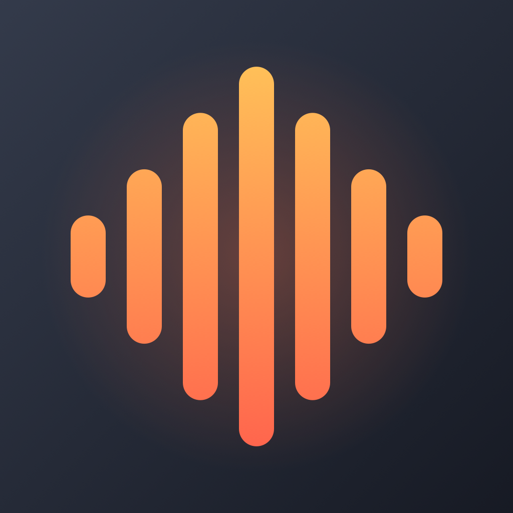

# BensVoice

A tiny macOS menu bar app (and [iPhone keyboard](#iphone)) for talking to your computer, with two hotkeys:

- **Dictate**: speech to text in whatever field is focused, transcribed **locally** with NVIDIA's Parakeet model on the Apple Neural Engine.
- **Compose**: say what you want written ("reply saying Thursday works but Friday's out"), and Claude Haiku writes it and pastes it in. It's a lightweight take on apps like Lemon Voice, using your Claude Code subscription.

About 600 lines of Swift with no dependencies. It uses about 40 MB of RAM and 0% CPU when idle, and the mic only runs while you hold a key.

| Key | Action |
| --- | --- |
| Hold **Right ⌥ Option** | Dictate, release to paste |
| Hold **Right ⌘ Command** | Compose with Haiku, release to paste |
| Quick tap either key | Hands-free mode, tap again to finish |
| **Esc** | Cancel |

The menu bar icon shows the state: waveform (ready), mic (dictating), sparkles (composing), spinner (transcribing / waiting on Haiku).

In compose mode, Haiku also gets the name of the app you're in (casual tone for Slack, professional for Mail, technical for Terminal) and any text you have selected (e.g. the message you're replying to, or text to rewrite).

## Requirements

- **Apple Silicon Mac** running **macOS 13+**
- **Swift toolchain**: Xcode or just the Command Line Tools (`xcode-select --install`)
- **Parakeet model** (~450 MB, see below)
- For compose mode, **one of**:
  - [Claude Code](https://docs.claude.com/en/docs/claude-code) installed and logged in with your Claude subscription, **or**
  - an Anthropic API key

## Install

### 1. Get the code

```bash
git clone https://github.com/benlaval23/bensvoice.git
cd bensvoice
```

### 2. Download the Parakeet model

If you already use [FluidVoice](https://github.com/altic-dev/FluidVoice) and have downloaded Parakeet v2 there, **skip this step**: BensVoice reads the same files.

Otherwise:

```bash
./download-model.sh
```

This fetches [`FluidInference/parakeet-tdt-0.6b-v2-coreml`](https://huggingface.co/FluidInference/parakeet-tdt-0.6b-v2-coreml) from Hugging Face into
`~/Library/Application Support/FluidAudio/Models/parakeet-tdt-0.6b-v2-coreml`. To put it somewhere else, pass a path (`./download-model.sh ~/models/parakeet`) and set `modelDir` in the config (below).

### 3. Set up Claude (for compose mode)

**Option A: Claude Code subscription (default).** Install Claude Code and log in once:

```bash
curl -fsSL https://claude.ai/install.sh | bash
claude   # then run /login
```

Check that it works: `echo "say hi" | claude -p --model haiku`. BensVoice runs this CLI in the background, so nothing else is needed. Each compose takes about 2–3 s.

**Option B: API key (faster, ~1 s, billed per use).** Create `~/Library/Application Support/BensVoice/config.json`:

```json
{ "anthropicApiKey": "sk-ant-...", "model": "claude-haiku-5-5" }
```

### 4. Build and launch

```bash
./build.sh
open ~/Applications/BensVoice.app
```

`build.sh` compiles a release build, wraps it in an app bundle, signs it (with your Apple Development certificate if you have one, otherwise ad-hoc) and installs it to `~/Applications`.

### 5. Grant permissions

On first launch, macOS asks for:

- **Accessibility** (System Settings › Privacy & Security › Accessibility): needed to see the hotkeys and paste text. The menu bar icon shows ⚠️ until it's granted, then switches to the waveform automatically.
- **Microphone**: asked the first time you record.

Then click the menu bar icon and turn on **Launch at Login**.

The very first model load takes ~15 s while macOS compiles it for the Neural Engine. After that it starts in under a second.

> **Ad-hoc signing note:** without an Apple Development certificate, macOS forgets the Accessibility permission each time you rebuild. If hotkeys stop working after `./build.sh`, remove BensVoice from the Accessibility list and add it again.

## Configuration

Optional `~/Library/Application Support/BensVoice/config.json`:

| Key | Default | Purpose |
| --- | --- | --- |
| `anthropicApiKey` | none | Use the API directly instead of the `claude` CLI |
| `model` | `claude-haiku-5-5` | Model when using an API key |
| `cliModel` | `haiku` | Model alias passed to `claude -p --model` |
| `modelDir` | FluidAudio folder | Where the Parakeet model lives |

To change the hotkeys, edit `AppDelegate.keys` in `Sources/BensVoice/main.swift` (macOS key codes: 61 right ⌥, 58 left ⌥, 54 right ⌘, 62 right ⌃) and rebuild.

## Troubleshooting

- **Nothing happens when I hold the key**: check the menu bar icon. ⚠️ means Accessibility isn't granted. Click the icon to see the status line.
- **Two apps react to the same key**: quit FluidVoice, Superwhisper, or any other dictation app that uses the same hotkey.
- **Compose says it couldn't find `claude`**: BensVoice looks in `~/.local/bin`, `~/.claude/local`, `/opt/homebrew/bin` and `/usr/local/bin`.
- **Test transcription without the GUI**: `.build/release/BensVoice --transcribe some.wav`

## How it works

- `Parakeet.swift`: a minimal TDT greedy decoder over the four CoreML models (preprocessor, encoder, LSTM decoder, joint). Audio longer than 15 s is split at the quietest point near each boundary.
- `Recorder.swift`: AVAudioEngine to 16 kHz mono. The engine only runs while recording.
- `Composer.swift`: the Haiku prompt, through either the `claude` CLI or the Messages API.
- `TextInsertion.swift`: pastes through a temporary clipboard swap, then restores your clipboard. Also reads selected text via Accessibility.

## iPhone

`iOS/` is an iPhone version that works as a **keyboard**, like Wispr Flow. It uses the same Parakeet decoder and Haiku prompt as the Mac app (the Swift files are shared).

<p align="center"></p>

- Tap 🌐 to switch to the BensVoice keyboard. It has two buttons: 🎙 **Dictate** and ✎ **Compose**.
- Tap one, talk, and tap it again. Parakeet transcribes on the phone (and Haiku writes it, for Compose), and the text is typed straight into the field.
- In Compose, Haiku also sees the text before the cursor, or your selection, so "reply saying Thursday works" or "make this more formal" work.

**Why it opens the app once:** iOS doesn't let keyboards use the microphone. The first tap opens BensVoice, which turns the mic on, and you tap **◀** in the top-left corner to go back. The app keeps the mic session running in the background (orange dot, and a Live Activity in the Dynamic Island) for 5 minutes to 4 hours after you last use it, so later taps work straight from the keyboard. The keyboard and app talk through an App Group and Darwin notifications.

### Setup

1. Install **Xcode** from the Mac App Store and open it once to add the iOS platform.
2. Generate the Xcode project with [XcodeGen](https://github.com/yonaskolb/XcodeGen): `brew install xcodegen && cd iOS && xcodegen generate`. Run it again whenever you change `iOS/project.yml`.
3. In `iOS/project.yml`, set `DEVELOPMENT_TEAM` to your team ID and change the `com.benlaval` bundle IDs and the App Group (`group.com.benlaval.bensvoice`, also in `Shared/Bridge.swift`) to your own.
4. Open `iOS/BensVoice.xcodeproj`, plug in your iPhone, select it and press ⌘R. Turn on **Developer Mode** on the phone if asked (Settings › Privacy & Security).
5. In the app: download the speech model (450 MB), allow the microphone, and paste an Anthropic API key for Compose.
6. Tap **Turn on the keyboard**, then Keyboards › turn on **BensVoice** and **Allow Full Access** (needed for the keyboard to reach the app; BensVoice doesn't send what you type anywhere).

With a free Apple ID the app stops opening after 7 days until you run it from Xcode again. A paid developer account ($99/year) makes that a year.

## Credits

- [NVIDIA Parakeet TDT 0.6B v2](https://huggingface.co/nvidia/parakeet-tdt-0.6b-v2) (CC-BY-4.0)
- CoreML conversion by [FluidInference / FluidAudio](https://github.com/FluidInference/FluidAudio)

## License

MIT
